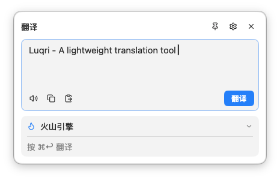
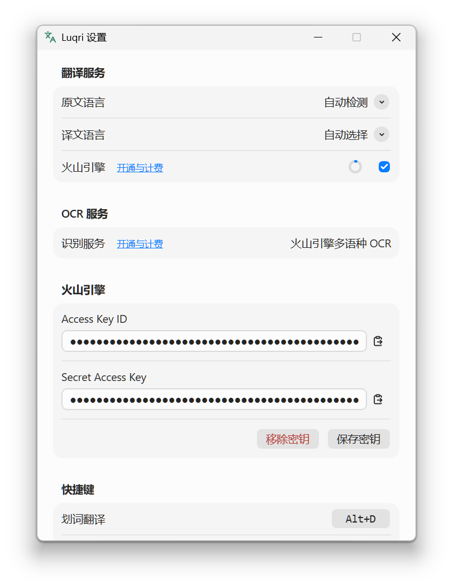

<p align="center">
  
</p>

<p align="center">
  
</p>

<h1 align="center">Luqri</h1>

<p align="center">一款轻量级原生多平台识别翻译工具</p>

<p align="center">
  <a href="macOS/README.md">macOS 文档</a> · <a href="Windows/README.md">Windows 文档</a>
</p>

<p align="center">
  <a href="LICENSE"></a>
  <a href="#平台"></a>
  <a href="https://github.com/TermiQue/luqri/releases"></a>
</p>

---

## 详细介绍

Luqri 用来在当前应用里翻译和提取文字。阅读网页、文档或聊天时，选中文字后按快捷键即可打开翻译浮窗。遇到无法直接复制的文字，可以框选屏幕区域，将识别结果复制到剪贴板，或接着翻译。浮窗也支持手动输入和翻译剪贴板内容。

应用平时运行在 macOS 菜单栏或 Windows 托盘中，翻译浮窗和截图界面按需打开。两端沿用相同的操作方式，并使用各自平台的窗口、快捷键和截图接口。

## 功能特性

- **划词翻译**。选中文字后直接查看译文，也可在浮窗中输入或粘贴原文。
- **截图 OCR**。框选屏幕区域，识别文字并复制到剪贴板。
- **截图翻译**。框选后在浮窗中同时显示识别出的原文和译文。
- **快捷键与朗读**。三组全局快捷键均可自定义，支持使用系统语音朗读中英文。
- **云端用量**。在设置中查看火山引擎机器翻译当月的已入账用量。

## 截图

<table>
  <thead>
    <tr>
      <th scope="col" width="50%">macOS</th>
      <th scope="col" width="50%">Windows</th>
    </tr>
  </thead>
  <tbody>
    <tr><th colspan="2">翻译框</th></tr>
    <tr>
      <td align="center" valign="top"></td>
      <td align="center" valign="top"></td>
    </tr>
    <tr><th colspan="2">设置</th></tr>
    <tr>
      <td align="center" valign="top"></td>
      <td align="center" valign="top"></td>
    </tr>
    <tr><th colspan="2">截图</th></tr>
    <tr>
      <td align="center" valign="top"></td>
      <td align="center" valign="top"></td>
    </tr>
  </tbody>
</table>

## 快速开始

### 下载安装

从 [GitHub Releases](https://github.com/TermiQue/luqri/releases) 下载对应的安装包。

- **macOS**。打开通用版 DMG，将 Luqri 拖入「应用程序」并启动。首次使用划词或截图时，按提示授予对应权限。文件名以 `-adhoc.dmg` 结尾的安装包使用临时签名，供本地测试。 [macOS 安装与权限](macOS/README.md)
- **Windows**。按处理器架构运行 `Luqri-Setup-x64.exe` 或 `Luqri-Setup-arm64.exe`。启动后从任务栏通知区域打开设置。 [Windows 安装说明](Windows/README.md)

| 操作 | macOS | Windows |
| --- | --- | --- |
| 划词翻译 | `⌥D` | `Alt+D` |
| 截图 OCR | `⌥W` | `Alt+W` |
| 截图翻译 | `⌥S` | `Alt+S` |

### 配置火山引擎

macOS 默认使用 Apple 翻译和 Apple Vision，可直接使用。Windows 的文本翻译和截图识别使用火山引擎，需要先配置密钥。

1. 在火山引擎按需开通文本翻译、多语种 OCR，或同时开通两项。 [机器翻译开通与计费](https://docs.volcengine.com/docs/machine-translation/product-billing) · [多语种 OCR](https://docs.volcengine.com/docs/large-model-of-image-generation/ability-to-introduce-1)
2. 在火山引擎访问控制控制台中进入「资源管理 → 密钥管理」，创建访问密钥并获取 `Access Key ID` 和 `Secret Access Key`。所用账号需要有权调用已开通的服务。 [访问控制控制台](https://console.volcengine.com/iam) · [获取访问密钥](https://docs.volcengine.com/docs/cp/signature-mechanism?lang=zh)
3. 打开 Luqri 设置，在「火山引擎」中填写两个字段并点击「保存密钥」。使用云端翻译时勾选火山引擎翻译。macOS 使用云端截图识别时，在「OCR 服务」中选择火山引擎。Windows 的截图识别使用火山引擎多语种 OCR。
4. 如果需要查看当月的翻译字符用量，为所用密钥授予费用中心 `ListBillDetail` 的调用权限。悬停在设置里的用量环上可查看已用量和本月免费额度。 [账单管理 API](https://docs.volcengine.com/docs/billing-center/openapi-interface-list?lang=zh)

云端翻译会向火山引擎发送待译文字，云端 OCR 会发送框选的截图。截图翻译会将识别结果交给已启用的翻译服务。

在设置中可指定原文和译文语言。译文设为「自动选择」时，中文原文译为英语，其余原文译为简体中文。

## 项目架构

```text
macOS/
  Luqri/                 Swift 源码与原生资源
  Luqri.xcodeproj/        Xcode 工程
  scripts/               构建应用、生成 DMG 与公证
Windows/
  Luqri.Windows.csproj    WPF 工程，源码与资源位于同一目录
  Luqri.iss               Inno Setup 安装定义
  scripts/               构建应用与安装程序
```

两端分别实现选区读取、截图、窗口和服务调用。划词翻译先读取文本选区，再把结果送入翻译浮窗。截图 OCR 与截图翻译复用同一条识别流程，识别结果分别送入剪贴板或翻译浮窗。

## 技术栈

| 平台 | 界面与系统集成 | 翻译、识别与朗读 |
| --- | --- | --- |
| macOS | Swift、SwiftUI、AppKit、ScreenCaptureKit | Apple Translation、Vision、AVFoundation、火山引擎 API |
| Windows | C#、.NET 10、WPF、Win32、Windows UI Automation | 火山引擎 API、System.Speech |

## 平台

| 平台 | 系统要求与架构 | 文档 |
| --- | --- | --- |
| macOS | macOS 15.0 及以上 · Apple Silicon、Intel | [macOS 文档](macOS/README.md) |
| Windows | 支持 .NET 10 的 Windows 系统 · x64、ARM64 | [Windows 文档](Windows/README.md) · [.NET 系统要求](https://learn.microsoft.com/zh-cn/dotnet/core/install/windows) |

## 开发

**macOS** 使用 Xcode 16.3 或更新版本。在仓库根目录运行以下命令，也可在 Xcode 中打开 `macOS/Luqri.xcodeproj`。 [macOS 构建与公证](macOS/README.md#构建)

```sh
cd macOS
./scripts/build.sh
open .build/Luqri.app
```

**Windows** 使用 .NET 10 SDK。构建脚本默认生成 x64 与 ARM64 的自包含版本。打包安装程序还需要 Inno Setup。 [Windows 构建与打包](Windows/README.md#构建)

```powershell
Set-Location Windows
.\scripts\build-windows.ps1
```

## 许可证

Luqri 采用 [MIT 许可证](LICENSE)。界面使用 Lucide SVG 图标，按各端随附的第三方许可证分发。 [macOS 的 Lucide 许可证](macOS/Luqri/Lucide-LICENSE.txt) · [Windows 的 Lucide 许可证](Windows/Lucide-LICENSE.txt)
