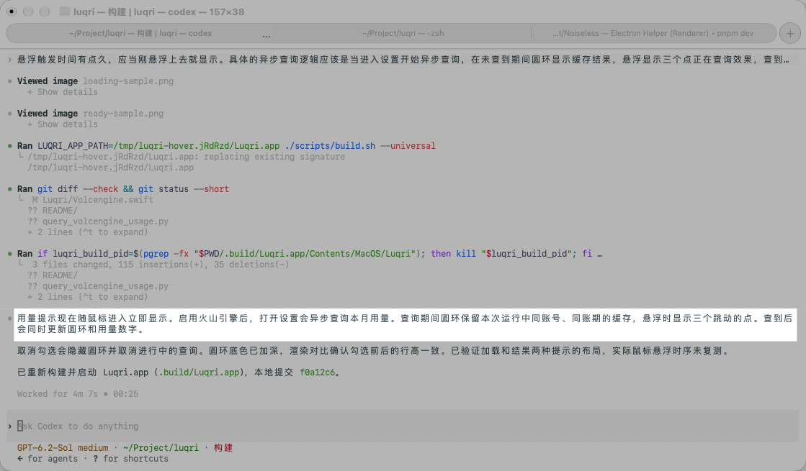
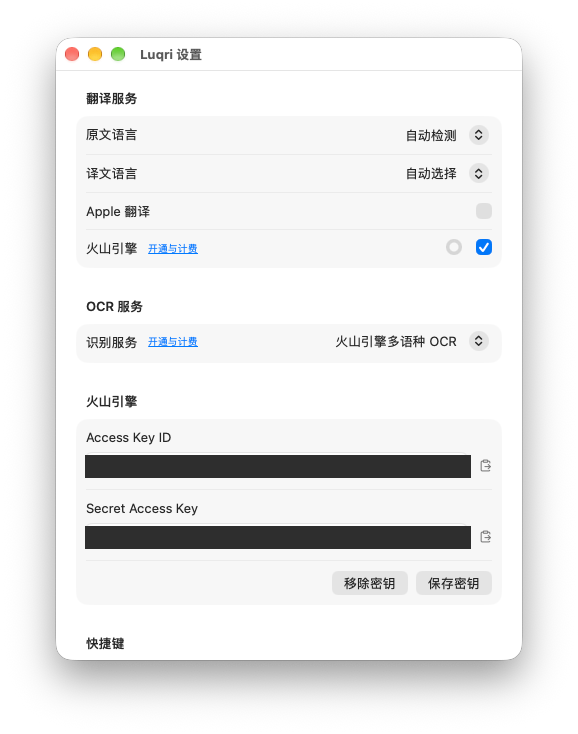

#  Luqri

Luqri 是 macOS 原生的菜单栏翻译与文字识别工具，支持划词翻译、截图 OCR 和截图翻译。使用 Swift、AppKit 和 SwiftUI，翻译浮窗、截图和 OCR 均按需运行。

## Windows 原生版

`windows-native` 分支包含基于 WPF 和 Win32 的 Windows 桌面版。启动后在任务栏通知区域打开 Luqri。左键打开设置，右键可运行命令或退出。首次使用时请在设置里填写火山引擎 Access Key ID 和 Secret Access Key，并开通机器翻译和多语种 OCR。机器翻译默认开启，OCR 固定使用火山引擎。翻译文本和框选截图会分别发送给对应的火山引擎接口，密钥由 Windows DPAPI 加密后保存在 `%LOCALAPPDATA%\Luqri`。

| 默认快捷键 | 操作 |
| --- | --- |
| `Alt+D` | 翻译当前选区。读不到文字时打开输入浮窗。 |
| `Alt+S` | 框选截图，显示识别出的原文并翻译。 |
| `Alt+W` | 框选截图，将识别出的文字复制到剪贴板。 |
| `Enter` / `Ctrl+Enter` | 翻译当前输入，`Shift+Enter` 换行。 |
| `Esc` | 取消截图或快捷键录制，关闭浮窗或设置。 |
| `Ctrl+,` / `Ctrl+W` / `Ctrl+Q` | 从浮窗打开设置、关闭当前窗口、退出 Luqri。 |
| `Ctrl+M` / `Ctrl+H` | 最小化设置窗口、隐藏 Luqri 窗口。 |

可在设置中重新录制三组全局快捷键。划词优先使用 Windows UI 自动化，读不到时尝试模拟 `Ctrl+C` 并恢复剪贴板。Windows 剪贴板历史可能记录临时复制的文字。朗读使用已安装的中英文桌面语音。设置里的用量环显示当月已入账字符数，查询需要账单明细权限。

### 构建 Windows 版

在 Windows 上安装 .NET 10 SDK，在仓库根目录运行以下命令。脚本默认生成 x64 自包含目录，目标电脑可直接运行目录中的 `Luqri.exe`。

```powershell
.\scripts\build-windows.ps1 -Package
.\.build\Luqri-win-x64\Luqri.exe --settings
```

`-Runtime win-arm64` 可构建 ARM64 版。`-Package` 额外生成 ZIP 和 SHA-256 校验文件。

以下安装和构建说明适用于 macOS 版。

## 界面截图

### 翻译浮窗


### 截图 OCR



### 设置



## 安装

Luqri 支持 macOS 15.0 及以上版本，可在 Apple Silicon 和 Intel Mac 上运行。打开已完成 Developer ID 签名和 Apple 公证的通用版 DMG，将 Luqri 拖入「应用程序」，再从那里启动。菜单栏出现翻译图标后即可使用。

升级时先退出旧版，再替换「应用程序」中的 Luqri。如果更新后仍提示授权，在系统设置中移除旧的 Luqri 条目，再添加并启用实际运行的版本。

## 使用

| 默认快捷键 | 操作 |
| --- | --- |
| `⌥D` | 翻译选中文字。读不到选区时打开输入框。 |
| `⌥W` | 拖动框选屏幕区域，识别文字并复制到剪贴板。 |
| `⌥S` | 拖动框选屏幕区域，识别后在翻译浮窗中显示原文和译文。 |
| `↩` / `⌘↩` | 翻译当前输入。在输入框中按 `⇧↩` 换行。 |
| `Esc` | 取消截图和快捷键录制，或关闭翻译浮窗和设置窗口。 |
| `⌘,` | Luqri 在前台时打开设置。也可从菜单栏打开。 |
| `⌘W` | 关闭当前设置窗口或翻译浮窗。 |
| `⌘M` / `⌘H` / `⌘Q` | 最小化设置窗口、隐藏 Luqri 或退出。 |

三个全局快捷键可在设置中更改。macOS 15.0 和 15.1 可能拒绝仅含 Option 键的全局快捷键，可以改用带 Command 或 Control 的组合。 [Apple 开发者论坛说明](https://developer.apple.com/forums/thread/763878)

划词翻译优先用辅助功能读取选区，读不到时尝试模拟一次 `⌘C`。Luqri 等剪贴板稳定后读取新文本，再尝试恢复原内容。系统或第三方剪贴板历史工具可能记录这次临时复制。

输入框支持手动输入和粘贴，也可以用剪贴板按钮立即翻译。原文和译文较长时可在各自区域内滚动。浮窗可置顶，并支持折叠各服务的结果。中文和英文朗读使用本地语音，点击扬声器后才启动。

## 系统权限

首次使用划词或截图时，点击「前往授权」。系统设置打开后，把小窗中的 Luqri 拖入相应列表，再开启开关。

| 功能 | 在「隐私与安全」中选择 |
| --- | --- |
| 划词翻译 | macOS 27.0–27.2 使用「设备控制和数据访问」。显示「辅助功能」的版本使用该列表。 |
| OCR 识别和 OCR 翻译 | 使用上方「录屏与系统录音」列表，旧版称为「屏幕与系统音频录制」。「仅系统录音」无法用于截图。 |

如果 macOS 提示退出并重新打开应用，重启后再试一次。 [Apple 录屏授权说明](https://support.apple.com/zh-cn/guide/mac-help/mchld6aa7d23/mac)

## 服务与数据

- **Apple 翻译**默认开启。首次使用某个语种时，系统可能提示下载语言包，下载后可离线翻译。
- **火山引擎机器翻译**需先开通服务，并在 Luqri 设置中填写 Access Key ID 和 Secret Access Key。启用后，待翻译文本会发送给火山引擎。两个翻译服务可以同时开启，结果各自显示。打开设置时会异步刷新火山引擎本月已入账用量。用量环悬停显示已用量和月免费额度，单位为万字符。 [开通与计费](https://docs.volcengine.com/docs/machine-translation/product-billing)
- **OCR 服务**单选。Apple Vision 默认在本机识别。选择火山引擎多语种 OCR 时，所选截图会发送给火山引擎。OCR 翻译会把识别出的文字再交给启用的翻译服务。 [火山引擎多语种 OCR](https://docs.volcengine.com/docs/large-model-of-image-generation/ability-to-introduce-1)
- **语言**在设置中选择。使用「自动选择」时，中文原文译为英文，其余原文译为简体中文。
- **火山引擎密钥**两个字段均支持 `⌘V`。密钥存放在本机的 `~/Library/Application Support/Luqri/volcengine.json`，文件权限为 `0600`，可通过设置中的「移除密钥」删除。

## 构建

使用 Xcode 16.3 或更新版本提供的 Swift 工具链和 macOS SDK。在 Xcode 中打开 `Luqri.xcodeproj` 后可运行 `Luqri` scheme。也可以在仓库根目录运行以下命令。

```sh
./scripts/build.sh
open .build/Luqri.app
```

传入 `--universal` 可构建 Apple Silicon 和 Intel 通用应用。构建脚本使用临时签名（ad hoc），适合本地开发。

## 打包与公证

用以下命令生成本地验证用的通用 DMG 和 SHA-256 文件。

```sh
./scripts/package.sh --local
```

产物生成在 `.build/`。暂未取得 Developer ID 签名或公证的本地测试包使用 `-adhoc.dmg` 后缀。

公开分发时，先将 Developer ID Application 证书及私钥装入钥匙串，并为 `notarytool` 保存钥匙串凭据，再运行以下命令。

```sh
LUQRI_SIGN_IDENTITY='Developer ID Application: 你的签名身份' \
LUQRI_NOTARY_PROFILE='你的钥匙串凭据名称' \
./scripts/package.sh
```

脚本会签名应用与 DMG，提交 Apple 公证，附加并验证公证票据，再挂载校验包内应用的签名和两种架构。 [Apple 打包说明](https://developer.apple.com/documentation/xcode/packaging-mac-software-for-distribution) · [Apple 公证说明](https://developer.apple.com/documentation/security/customizing-the-notarization-workflow)

在 `.build` 中运行 `shasum -a 256 -c <包名>.dmg.sha256` 可以校验对应 DMG。发布前在目标 Mac 上验证启动、三组快捷键、屏幕授权、OCR 以及语言包下载。测试火山引擎时使用有权限的账号密钥。

## 图标

界面使用 Lucide SVG 图标，随应用分发。 [Lucide](https://lucide.dev/) · [许可证](Luqri/Lucide-LICENSE.txt)
