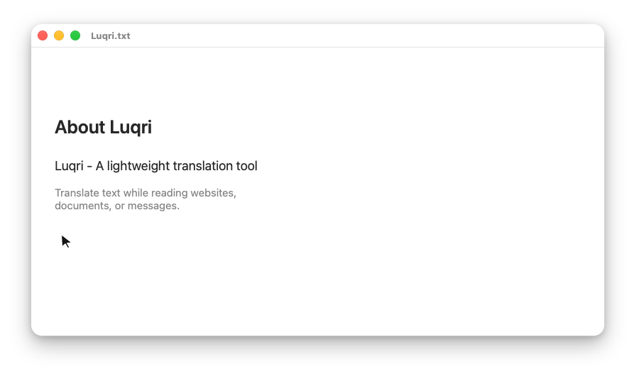
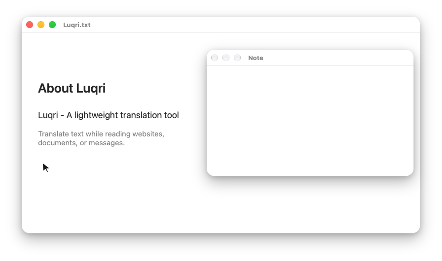
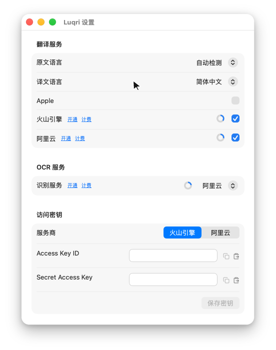
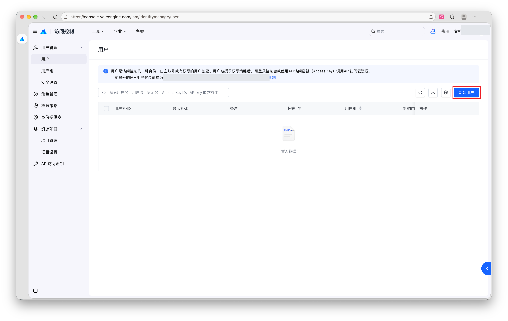
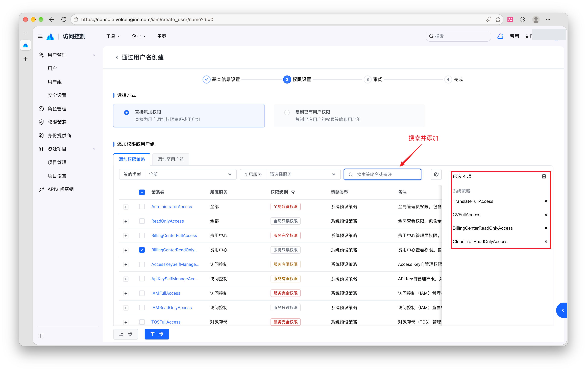
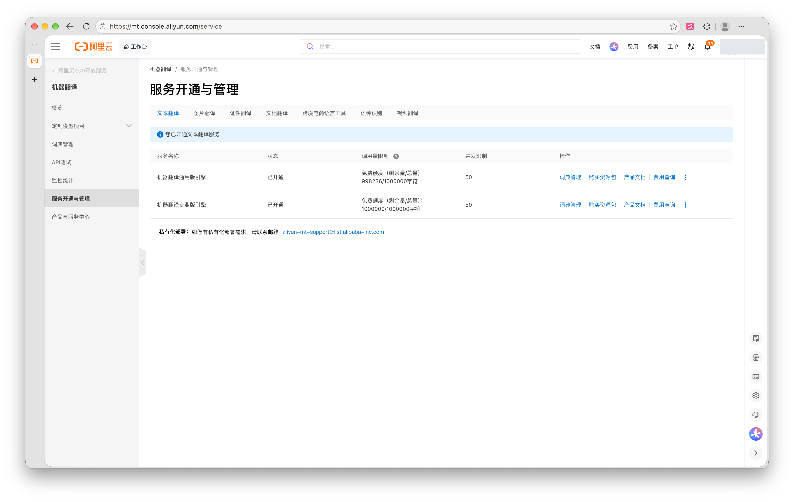
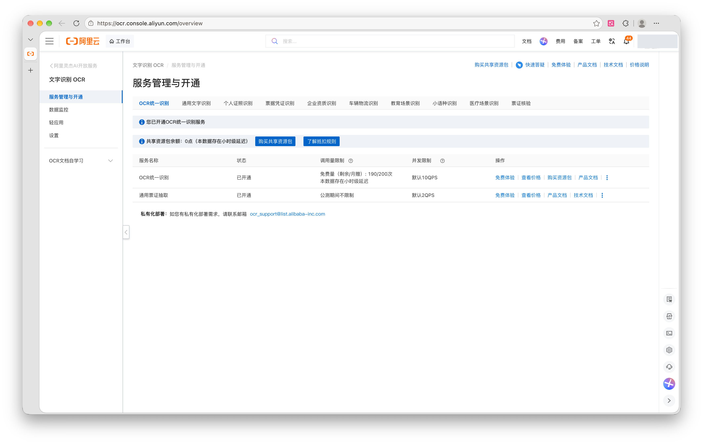

<p align="center">
  
</p>

<p align="center">
  
</p>

<h1 align="center">Luqri</h1>

<p align="center">一款轻量级原生多平台识别翻译工具</p>


<p align="center">
  <a href="LICENSE"></a>
  <a href="#平台"></a>
  <a href="https://github.com/TermiQue/luqri/releases/latest"></a>
</p>

---

## 详细介绍

Luqri 用来在当前应用里翻译和提取文字。阅读网页、文档或聊天时，选中文字后按快捷键即可打开翻译浮窗。遇到无法直接复制的文字，可以框选屏幕区域，将识别结果进行翻译或复制到剪贴板。浮窗也支持手动输入和翻译剪贴板内容。

应用平时运行在 macOS 菜单栏或 Windows 托盘中，翻译浮窗和截图界面按需打开。两端沿用相同的操作方式，并使用各自平台的窗口、快捷键和截图接口。

## 功能特性

- **划词翻译：** 选中文字后直接查看译文，也可在浮窗中输入或粘贴原文。

  

- **截图 OCR：** 框选屏幕区域，识别文字并复制到剪贴板。

  

- **截图翻译：** 框选后在浮窗中同时显示识别出的原文和译文。

  

- **云端用量：** 在设置中查看翻译和 OCR 用量。

  

## 快速开始

### 下载安装

从 [GitHub Releases](https://github.com/TermiQue/luqri/releases) 下载对应的安装包。

- **macOS**。打开通用 DMG，将 Luqri 拖入「应用程序」后启动。设置可从菜单栏打开。首次使用相关功能时，需依随指引完成权限授权。
- **Windows**。按处理器架构选择 x64 或 ARM64 安装包。启动后左键点击通知区域的 Luqri 图标即可打开设置。

默认快捷键：

| 操作 | macOS | Windows |
| --- | --- | --- |
| 划词翻译 | `⌥D` | `Alt+D` |
| 截图 OCR | `⌥W` | `Alt+W` |
| 截图翻译 | `⌥S` | `Alt+S` |

### 服务供应商

macOS 默认使用 Apple 翻译和 Apple Vision，Windows 默认使用火山引擎。翻译可同时启用多个服务，OCR 单独选择一个服务。云端翻译会把待译文字发送给所选服务，云端 OCR 会发送框选的截图。

下表列出 Luqri 用于检查云端用量的免费额度。数据来自 2026 年 11 月 27 日。二者均需要创建账户并完成实名认证。

| 服务     | 阿里云        | 火山引擎      |
| -------- | ------------- | ------------- |
| 机器翻译 | 100 万字符/月 | 200 万字符/月 |
| OCR 识别 | 200 次/月     | 5,000 次（累计） |

#### 火山引擎

共需要开通 2 项服务，创建 1 个用户并赋予 4 项权限。

1. [机器翻译](https://console.volcengine.com/translate)

   

2. [多语种 OCR](https://console.volcengine.com/ai/ability/info/78)

   

3. [创建用户](https://console.volcengine.com/iam/identitymanage/user)

   

   

   

4. 授予权限：`TranslateFullAccess` 机器翻译、`CVFullAccess` 智能视觉、`BillingCenterReadOnlyAccess` 费用中心、`CloudTrailReadOnlyAccess` 操作审计

   

5. 获取密钥并配置：在用户详情的「密钥」页创建访问密钥。回到 Luqri 设置，在「访问密钥」中选择火山引擎并保存。

   

#### 阿里云

共需要开通 2 项服务，创建 1 个用户并赋予 3 项权限。

1. [机器翻译](https://mt.console.aliyun.com/service)

   

2. [文字识别](https://ocr.console.aliyun.com/overview)

   

3. [创建用户](https://ram.console.aliyun.com/users)

   

   

4. 授予权限：

   

5. 获取密钥并配置：创建用户完成后保存页面显示的 AccessKey。在 Luqri 设置的「访问密钥」中选择阿里云，填入并保存。

## 项目架构

```text
macOS/
  Luqri/                 Swift 源码与原生资源
  Luqri.xcodeproj/        Xcode 工程
  scripts/               构建应用、生成 DMG 与公证
Windows/
  Luqri.Windows.csproj    WPF 工程，源码与资源位于同一目录
  Luqri.iss               Inno Setup 安装定义
  scripts/               构建应用与安装程序
```

两端分别实现选区读取、截图、窗口和服务调用。划词翻译先读取文本选区，再把结果送入翻译浮窗。截图 OCR 与截图翻译复用同一条识别流程，识别结果分别送入剪贴板或翻译浮窗。

## 技术栈

| 平台 | 界面与系统集成 | 翻译、识别与朗读 |
| --- | --- | --- |
| macOS | Swift、SwiftUI、AppKit、ScreenCaptureKit | Apple Translation、Vision、AVFoundation、火山引擎和阿里云 API |
| Windows | C#、.NET 10、WPF、Win32、Windows UI Automation | 火山引擎和阿里云 API、System.Speech |

## 平台

| 平台 | 系统要求与架构 | 源码 |
| --- | --- | --- |
| macOS | macOS 15.0 及以上 · Apple Silicon、Intel | [macOS](macOS/) |
| Windows | 支持 .NET 10 的 Windows 系统 · x64、ARM64 | [Windows](Windows/) · [.NET 系统要求](https://learn.microsoft.com/zh-cn/dotnet/core/install/windows) |

## 开发

**macOS** 使用 Xcode 16.3 或更新版本。可在 Xcode 中打开 `macOS/Luqri.xcodeproj`，也可在仓库根目录运行以下命令。

```sh
cd macOS
./scripts/build.sh
open .build/Luqri.app
./scripts/package.sh --local  # 生成通用 DMG 与 SHA-256 文件
```

正式分发时，设置 `LUQRI_SIGN_IDENTITY` 和 `LUQRI_NOTARY_PROFILE` 后运行 `./scripts/package.sh`，使用 Developer ID 签名并提交 Apple 公证。

**Windows** 使用 .NET 10 SDK。构建脚本默认生成 x64 与 ARM64 的自包含版本。打包安装程序需要 Inno Setup 7.1 或更新版本。

```powershell
Set-Location Windows
.\scripts\build-windows.ps1
.\scripts\package-windows.ps1
```

两端产物分别写入 `macOS/.build/` 和 `Windows/.build/`。

## 许可证

Luqri 采用 [MIT 许可证](LICENSE)
