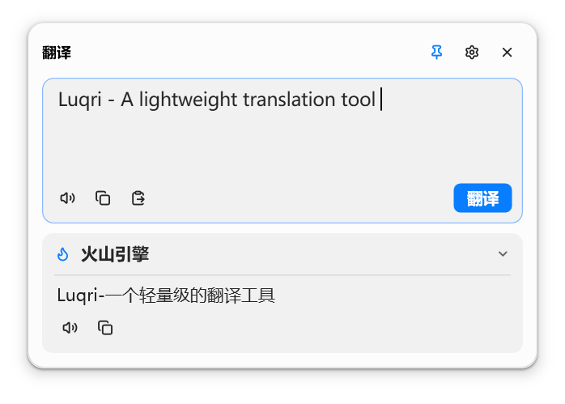
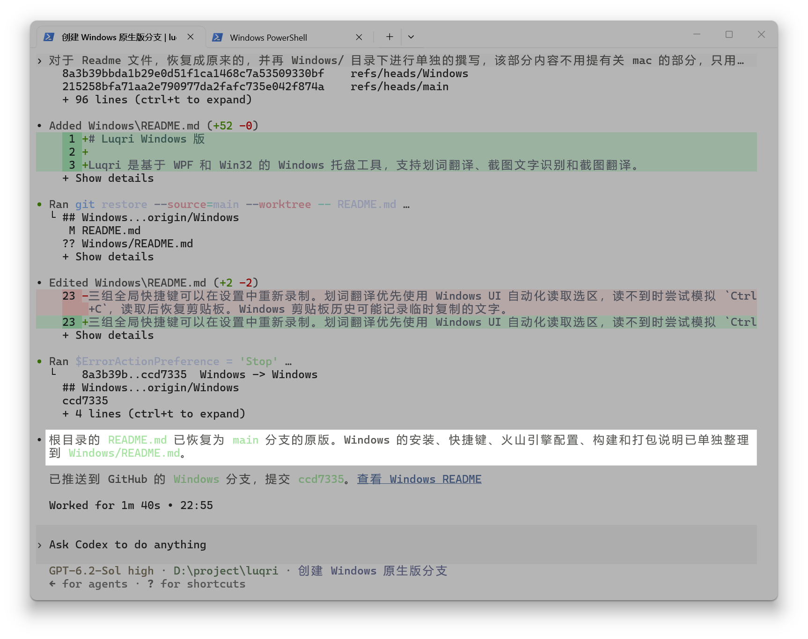
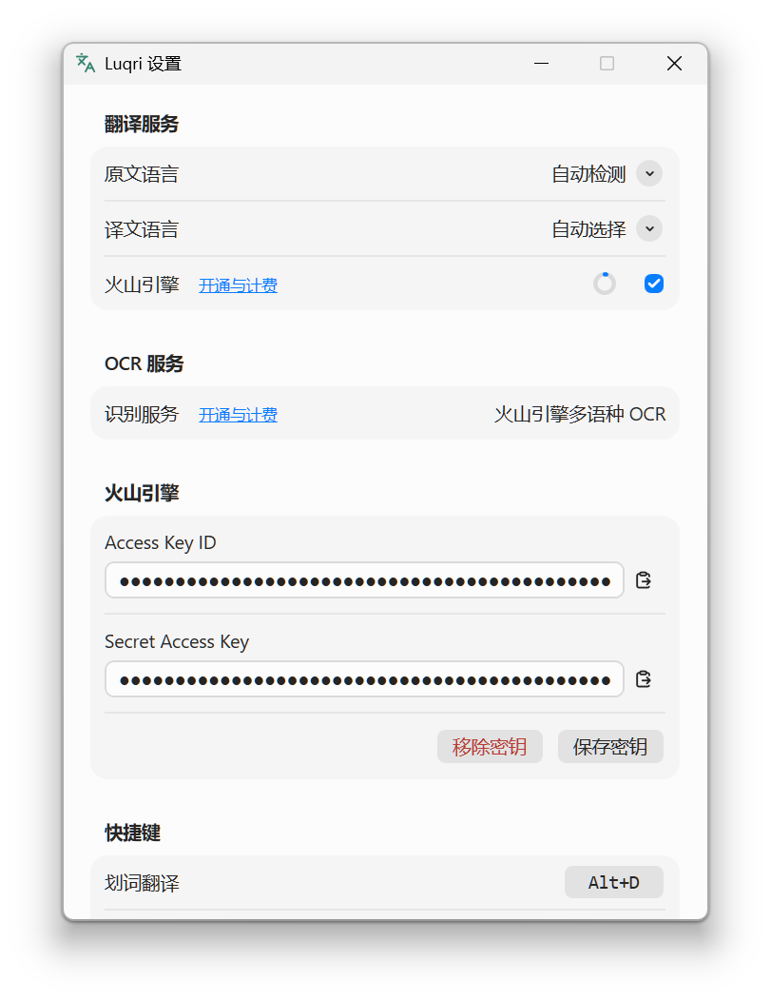

# Luqri Windows 版

Luqri 是基于 WPF 和 Win32 的 Windows 托盘工具，支持划词翻译、截图文字识别和截图翻译。

## 界面截图

### 翻译浮窗



### 截图 OCR



### 设置



## 安装

根据电脑的处理器架构运行 `Luqri-Setup-x64.exe` 或 `Luqri-Setup-arm64.exe`。安装包包含 .NET 桌面运行时，默认安装到当前用户的 `%LOCALAPPDATA%\Programs\Luqri`，并在开始菜单中创建 Luqri 快捷方式。也可以直接运行自包含目录中的 `Luqri.exe`。 [GitHub Releases](https://github.com/TermiQue/luqri/releases)

启动后，在任务栏通知区域左键点击 Luqri 打开设置，右键可以运行命令或退出。升级或卸载前先从托盘退出 Luqri。可在 Windows「已安装的应用」中卸载，卸载会保留设置和访问密钥。

## 使用

| 默认快捷键 | 操作 |
| --- | --- |
| `Alt+D` | 翻译选中文字。读不到选区时打开输入浮窗。 |
| `Alt+S` | 框选屏幕区域，识别文字并显示原文和译文。 |
| `Alt+W` | 框选屏幕区域，识别文字并复制到剪贴板。 |
| `Enter` / `Ctrl+Enter` | 翻译当前输入。在输入框内按 `Shift+Enter` 换行。 |
| `Esc` | 取消截图或快捷键录制，或关闭翻译浮窗和设置。 |
| `Ctrl+,` / `Ctrl+W` / `Ctrl+Q` | 从浮窗打开设置、关闭当前窗口或退出 Luqri。 |
| `Ctrl+M` / `Ctrl+H` | 最小化设置窗口或隐藏 Luqri 窗口。 |

三组全局快捷键可以在设置中重新录制。划词翻译优先使用 Windows UI 自动化读取选区，读不到时尝试模拟 `Ctrl+C`。读取后，Luqri 会尝试恢复剪贴板的原有内容。Windows 剪贴板历史可能记录临时复制的文字。

浮窗支持手动输入、翻译剪贴板内容、置顶和折叠译文。原文和译文可复制，也可使用系统已安装的中英文桌面语音朗读。

## 服务与数据

- 翻译和截图识别默认使用火山引擎，可以在设置中分别切换到阿里云。火山引擎的服务开通、密钥配置和用量查询见 [火山引擎通用配置](../README.md#配置火山引擎)。
- 在「访问密钥」中选中对应服务商后保存或移除密钥。密钥经 Windows DPAPI 加密，分别保存在 `%LOCALAPPDATA%\Luqri\volcengine.bin` 和 `%LOCALAPPDATA%\Luqri\aliyun.bin`。

### 阿里云

- 在阿里云开通「机器翻译通用版」和截图识别所需的「小语种识别」，再到 Luqri 的「访问密钥」选择「阿里云」，填写 AccessKey ID 和 AccessKey Secret。两项服务可以共用同一组密钥。 [机器翻译通用版](https://help.aliyun.com/zh/machine-translation/product-overview/pricing-of-machine-translation-general-purpose-edition) · [小语种识别](https://help.aliyun.com/zh/ocr/product-overview/recognition-of-characters-in-languages-except-for-chinese-and-english-1)
- RAM 子账号需获准调用 `alimt:TranslateGeneral` 和所选 OCR 服务的 `ocr:RecognizeMultiLanguage`。翻译用量环另需 `alimt:GetTranslateReport`，它按自然月汇总阿里云日报，以 100 万字符为参照估算进度。实际免费余额可到阿里云机器翻译控制台的「服务开通与管理」查看。 [翻译用量报表](https://help.aliyun.com/zh/machine-translation/developer-reference/api-alimt-2018-10-12-gettranslatereport) · [OCR 接口](https://help.aliyun.com/zh/ocr/developer-reference/api-ocr-api-2021-07-07-recognizemultilanguage)

## 构建

安装 .NET 10 SDK 后，进入 `Windows/` 目录运行以下命令。 [.NET 10 下载](https://dotnet.microsoft.com/download/dotnet/10.0)

```powershell
.\scripts\build-windows.ps1
```

脚本默认在 `.build\Luqri-win-x64` 和 `.build\Luqri-win-arm64` 生成自包含版本。单独构建某个架构时传入 `-Runtime win-x64` 或 `-Runtime win-arm64`。

## 打包安装程序

安装 Inno Setup 7.1 或更新版本后，在 `Windows/` 目录运行以下命令。可用 `-Compiler` 指定 `ISCC.exe` 的完整路径。 [Inno Setup 下载](https://jrsoftware.org/inno-setup/downloads)

```powershell
.\scripts\package-windows.ps1
```

脚本生成 `.build\Luqri-win-x64\Luqri-Setup-x64.exe` 和 `.build\Luqri-win-arm64\Luqri-Setup-arm64.exe`。也可用 `-Runtime` 仅打包指定架构。

## 图标

界面使用 Lucide SVG 图标，随应用分发。 [Lucide](https://lucide.dev/) · [许可证](Lucide-LICENSE.txt)
