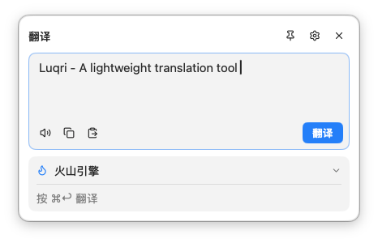
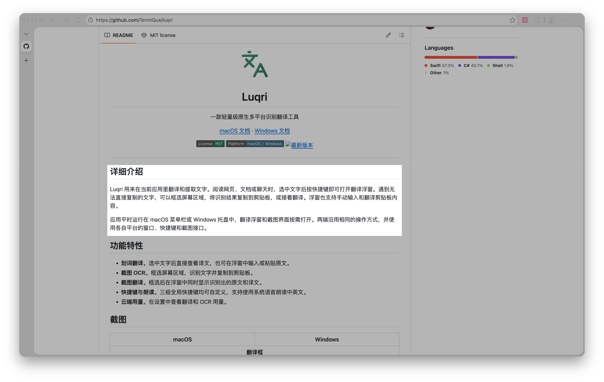
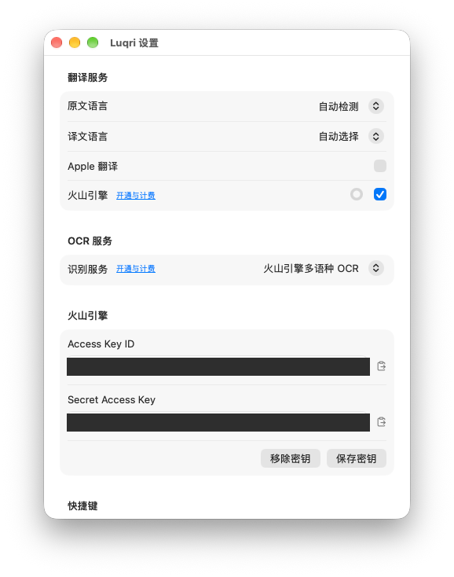

# Luqri macOS 版

Luqri 是 macOS 原生的菜单栏翻译与文字识别工具，支持划词翻译、截图 OCR 和截图翻译。使用 Swift、AppKit 和 SwiftUI，翻译浮窗、截图和 OCR 均按需运行。

## 界面截图

### 翻译浮窗



### 截图 OCR



### 设置



## 安装

Luqri 支持 macOS 15.0 及以上版本，可在 Apple Silicon 和 Intel Mac 上运行。打开通用版 DMG，将 Luqri 拖入「应用程序」，再从那里启动。菜单栏出现翻译图标后即可使用。以 `-adhoc.dmg` 结尾的安装包使用临时签名，供本地测试。 [GitHub Releases](https://github.com/TermiQue/luqri/releases)

升级时先退出旧版，再替换「应用程序」中的 Luqri。如果更新后仍提示授权，在系统设置中移除旧的 Luqri 条目，再添加并启用实际运行的版本。

## 使用

| 默认快捷键 | 操作 |
| --- | --- |
| `⌥D` | 翻译选中文字。读不到选区时打开输入框。 |
| `⌥W` | 拖动框选屏幕区域，识别文字并复制到剪贴板。 |
| `⌥S` | 拖动框选屏幕区域，识别后在翻译浮窗中显示原文和译文。 |
| `↩` / `⌘↩` | 翻译当前输入。在输入框中按 `⇧↩` 换行。 |
| `Esc` | 取消截图和快捷键录制，或关闭翻译浮窗和设置窗口。 |
| `⌘,` | Luqri 在前台时打开设置。也可从菜单栏打开。 |
| `⌘W` | 关闭当前设置窗口或翻译浮窗。 |
| `⌘M` / `⌘H` / `⌘Q` | 最小化设置窗口、隐藏 Luqri 或退出。 |

三个全局快捷键可在设置中更改。macOS 15.0 和 15.1 可能拒绝仅含 Option 键的全局快捷键，可以改用带 Command 或 Control 的组合。 [Apple 开发者论坛说明](https://developer.apple.com/forums/thread/763878)

划词翻译优先用辅助功能读取选区，读不到时尝试模拟一次 `⌘C`。Luqri 等剪贴板稳定后读取新文本，再尝试恢复原内容。系统或第三方剪贴板历史工具可能记录这次临时复制。

输入框支持手动输入和粘贴，也可以用剪贴板按钮立即翻译。原文和译文较长时可在各自区域内滚动。浮窗可置顶，并支持折叠各服务的结果。中文和英文朗读使用本地语音，点击扬声器后才启动。

## 系统权限

首次使用划词或截图时，点击「前往授权」。系统设置打开后，把小窗中的 Luqri 拖入相应列表，再开启开关。

| 功能 | 在「隐私与安全」中选择 |
| --- | --- |
| 划词翻译 | macOS 27.0–27.2 使用「设备控制和数据访问」。显示「辅助功能」的版本使用该列表。 |
| OCR 识别和 OCR 翻译 | 使用上方「录屏与系统录音」列表，旧版称为「屏幕与系统音频录制」。「仅系统录音」无法用于截图。 |

如果 macOS 提示退出并重新打开应用，重启后再试一次。 [Apple 录屏授权说明](https://support.apple.com/zh-cn/guide/mac-help/mchld6aa7d23/mac)

## 服务与数据

- **Apple 翻译**默认开启。首次使用某个语种时，系统可能提示下载语言包，下载后可离线翻译。可同时启用 Apple 翻译、火山引擎和阿里云，浮窗为每个服务分别显示译文。
- **OCR 服务**默认使用 Apple Vision 在本机识别。截图 OCR 和截图翻译共用此设置，也可选择火山引擎多语种 OCR 或阿里云 OCR 统一识别。云端 OCR 会发送框选的图像，云端翻译会发送待译文字。
- **访问密钥**按服务商单独保存。字段支持粘贴和复制，切换服务商会保留本次设置窗口中未保存的输入。保存的密钥位于 `~/Library/Application Support/Luqri/` 下的 `volcengine.json` 和 `aliyun.json`，文件权限为 `0600`。
- 设置中的用量环显示用量及应用采用的额度。火山引擎翻译、阿里云翻译和阿里云 OCR 按 UTC+8 自然月统计。达到额度、预计本次请求会超额或无法核验月用量时，应用会跳过对应请求。云端报表可能延迟，本机也记录已发出的请求。

### 火山引擎

- 在「访问密钥」选择火山引擎并保存密钥。翻译用量需要 `ListBillDetail` 权限，按每月 200 万字符核算。 [火山引擎配置](../README.md#配置火山引擎)
- 火山引擎 OCR 按 5,000 次累计用量检查。从首次启用用量统计的月份起记录，应用启动时和运行期间每小时通过操作审计 `LookupEvents` 合并近期可查到的调用。审计不可用时，用量环会标明当前仅显示已记录的用量。 [火山引擎操作审计](https://docs.volcengine.com/docs/operations-audit/lookup-events-query-the-list-of-audit-events?lang=zh)

### 阿里云

- 开通「机器翻译通用版」和「OCR 统一识别」中需要使用的服务。在「访问密钥」选择阿里云并保存 AccessKey。RAM 用户需有对应的 `alimt:TranslateGeneral` 或 `ocr:RecognizeAllText` 权限。 [机器翻译通用版](https://help.aliyun.com/zh/machine-translation/product-overview/pricing-of-machine-translation-general-purpose-edition) · [文字识别控制台](https://ocr.console.aliyun.com/overview)
- 翻译用量需要 `alimt:GetTranslateReport` 权限，按每月 100 万字符核算。OCR 用量需要 `actiontrail:LookupEvents` 权限，按每月 200 次核算。用量环以阿里云报表、可查到的审计事件及本机记录估算用量，实际余额以阿里云控制台为准。 [翻译用量报表](https://help.aliyun.com/zh/machine-translation/developer-reference/api-alimt-2018-10-12-gettranslatereport) · [操作审计](https://help.aliyun.com/en/actiontrail/developer-reference/api-actiontrail-2020-07-06-lookupevents)

## 构建

使用 Xcode 16.3 或更新版本提供的 Swift 工具链和 macOS SDK。在 Xcode 中打开本目录的 `Luqri.xcodeproj` 后可运行 `Luqri` scheme。也可以进入 `macOS/` 目录运行以下命令。

```sh
./scripts/build.sh
open .build/Luqri.app
```

传入 `--universal` 可构建 Apple Silicon 和 Intel 通用应用。构建脚本使用临时签名（ad hoc），适合本地开发。

## 打包与公证

在 `macOS/` 目录运行以下命令，生成本地验证用的通用 DMG 和 SHA-256 文件。

```sh
./scripts/package.sh --local
```

产物生成在 `.build/`。暂未取得 Developer ID 签名或公证的本地测试包使用 `-adhoc.dmg` 后缀。

公开分发时，先将 Developer ID Application 证书及私钥装入钥匙串，并为 `notarytool` 保存钥匙串凭据，再运行以下命令。

```sh
LUQRI_SIGN_IDENTITY='Developer ID Application: 你的签名身份' \
LUQRI_NOTARY_PROFILE='你的钥匙串凭据名称' \
./scripts/package.sh
```

脚本会签名应用与 DMG，提交 Apple 公证，附加并验证公证票据，再挂载校验包内应用的签名和两种架构。 [Apple 打包说明](https://developer.apple.com/documentation/xcode/packaging-mac-software-for-distribution) · [Apple 公证说明](https://developer.apple.com/documentation/security/customizing-the-notarization-workflow)

在 `.build` 中运行 `shasum -a 256 -c <包名>.dmg.sha256` 可以校验对应 DMG。发布前在目标 Mac 上验证启动、三组快捷键、屏幕授权、OCR 以及语言包下载。测试火山引擎时使用有权限的账号密钥。

## 图标

界面使用 Lucide SVG 图标，随应用分发。 [Lucide](https://lucide.dev/) · [许可证](Luqri/Lucide-LICENSE.txt)
